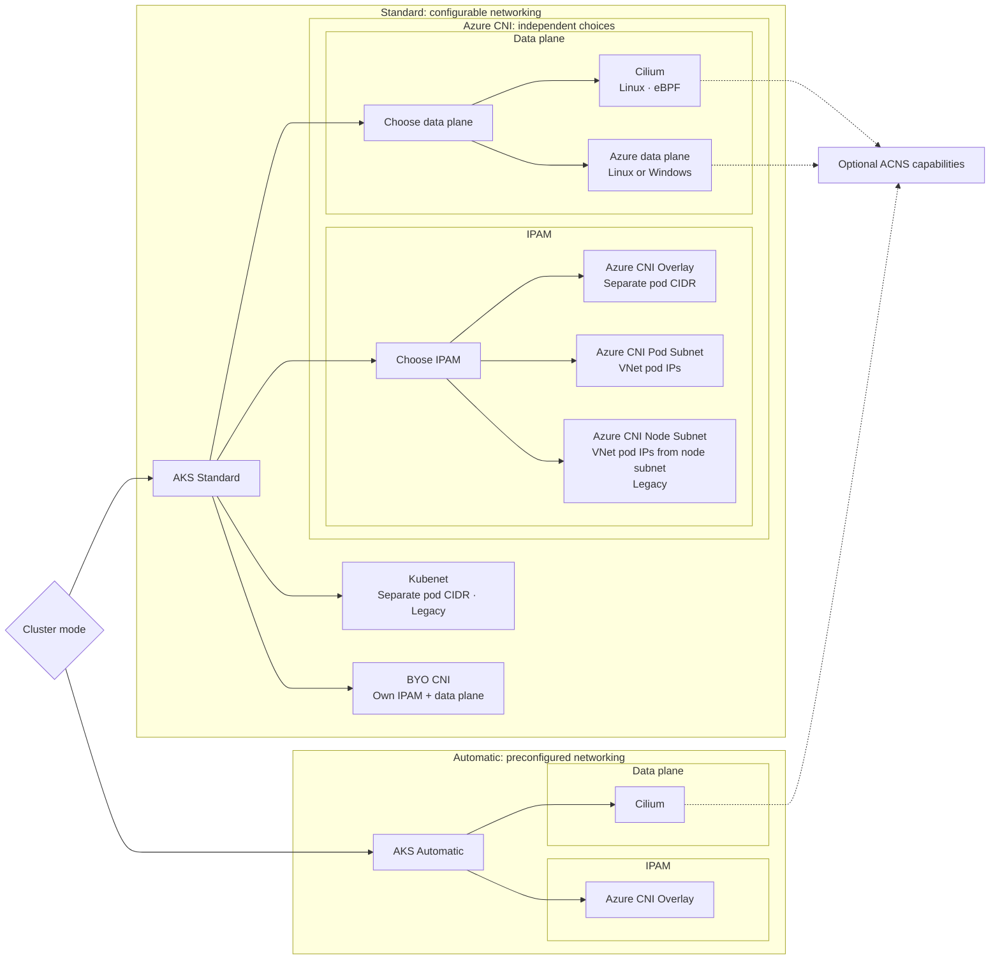
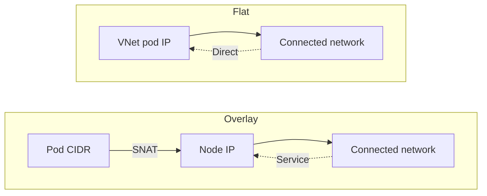

Two teams create AKS clusters on the same day. One discovers that its on-premises services can address pods directly. The other sees only node or load-balancer addresses. Both clusters are working as designed.

The difference starts with two decisions: where pod IP addresses come from, and which data plane moves and filters packets. After this page, you should be able to choose both deliberately, understand what AKS Automatic selects for you, and know when Advanced Container Networking Services (ACNS) adds value.

> **Version scope:** documentation checked on 12 October 2026 against the [AKS Cilium compatibility table](https://learn.microsoft.com/en-us/azure/aks/azure-cni-powered-by-cilium#supported-kubernetes-and-cilium-versions), which lists Kubernetes 1.31-1.36 and their minimum Cilium versions. This is not a guarantee of Kubernetes version availability in every region. Commands assume Azure CLI 2.86.0 or later, meeting the current [AKS Automatic requirement](https://learn.microsoft.com/en-us/azure/aks/automatic/quick-automatic-managed-network#before-you-begin); they are documentation-based examples, not deployment-tested configurations.
{: .prompt-info }

> **TL;DR for leaders**
>
> - Start with **Azure CNI Overlay powered by Cilium** for most Linux platforms.
> - Choose **Azure CNI Pod Subnet powered by Cilium** when systems outside the cluster must address pod IPs directly. Use Dynamic IP Allocation for address efficiency or [Static Block Allocation for scale up to one million pods](https://learn.microsoft.com/en-us/azure/aks/concepts-network-azure-cni-pod-subnet#static-block-allocation-mode).
> - Use the Azure data plane when you require Windows node pools; [Cilium on AKS is Linux-only](https://learn.microsoft.com/en-us/azure/aks/azure-cni-powered-by-cilium#limitations).
> - Choose **AKS Automatic** when you want Azure to [preconfigure Overlay, Cilium, LocalDNS, application routing, managed egress for the default VNet, and operational safeguards](https://learn.microsoft.com/en-us/azure/aks/intro-aks-automatic#networking).
> - Add **ACNS**, a [paid suite](https://learn.microsoft.com/en-us/azure/aks/container-network-security-fqdn-filtering-concepts#pricing), when you need managed network observability or advanced Cilium security, performance, and multi-cluster capabilities.
>
> IP addressing determines reachability and capacity. The data plane determines how traffic is forwarded and which operating systems, policy engines, and advanced networking capabilities are available.
{: .prompt-tip }

## Why the choice matters

Networking choices become application dependencies.

Your IP address management model determines how many VNet addresses a cluster consumes, whether connected networks can initiate traffic directly to pods, and which source address those networks observe. A poor initial subnet plan can limit upgrades or growth, while [overlay networking separates pod capacity from VNet address consumption](https://learn.microsoft.com/en-us/azure/aks/concepts-network-cni-overview#networking-models-in-aks).

The data plane implements service routing and network-policy enforcement. With Cilium, [eBPF programs loaded into the Linux kernel](https://learn.microsoft.com/en-us/azure/aks/azure-cni-powered-by-cilium) perform that work and provide the foundation for richer observability and security. AKS supports specific [forward-only IPAM migrations and data-plane updates](https://learn.microsoft.com/en-us/azure/aks/update-azure-cni#supported-migration-paths); these operations are separate and reimage node pools, so treat both choices as platform architecture.

### The decision map

Two terms organize the choices:

- **IPAM:** where pod IP addresses come from.
- **Data plane:** how packets are routed, translated, and filtered.



*[Kubenet](https://learn.microsoft.com/en-us/azure/aks/configure-kubenet) is a legacy plugin that assigns each node a `/24` from a separate pod CIDR; [BYO CNI](https://learn.microsoft.com/en-us/azure/aks/use-byo-cni) delegates IPAM and the data plane to the customer-managed plugin. The ACNS feature requirements below constrain which combinations you can use.*

## Decision 1: IPAM and network model

IP address management, or IPAM, answers a simple question: **where does a pod IP come from?** Microsoft calls networking in which pods receive VNet addresses a [**flat network**](https://learn.microsoft.com/en-us/azure/aks/concepts-network-cni-overview#flat-networks).



*Takeaway: overlay hides pod addresses behind nodes or services; flat networking makes pod addresses part of the connected private network.*

| Option | Pod IP source | Outside-cluster reachability | Private-network egress identity | Typical fit and scale |
|---|---|---|---|---|
| **Azure CNI Overlay — recommended** | Separate pod CIDR | Not directly; use a Service or ingress | Node IP through SNAT | Most clusters; conserves VNet space; up to 5,000 nodes and 200,000 pods |
| **Azure CNI Pod Subnet** | Dedicated VNet pod subnet | Direct from connected networks | Pod IP across connected VNets | Direct private pod reachability; Dynamic allocation for efficiency or Static Block allocation for scale |
| Azure CNI Node Subnet — legacy | Node VNet subnet | Direct from connected networks | Pod IP inside the cluster VNet; node IP outside it | Existing designs or a required AKS-managed VNet |
| Kubenet — legacy plugin | Separate pod CIDR | Not directly | Node IP through SNAT | Existing clusters that accept limited scale and user-defined route management; [retires on **31 March 2028**](https://learn.microsoft.com/en-us/azure/aks/concepts-network-legacy-cni) |

For internet destinations, the public source IP depends on the cluster's [configured outbound method](https://learn.microsoft.com/en-us/azure/aks/egress-outboundtype), not just the private-network identity shown above.

[Azure CNI Overlay supports up to **5,000 nodes and 200,000 pods per cluster**](https://learn.microsoft.com/en-us/azure/aks/plan-pod-networking#ip-address-management-ipam-options). Those are independent documented limits, not values to multiply. Pod Subnet instead scales within planned VNet address space and lets node and pod subnets grow independently.

[Overlay still requires IP planning](https://learn.microsoft.com/en-us/azure/aks/concepts-network-azure-cni-overlay#ip-address-planning): reserve a fixed `/24` of pod space per node, including growth and upgrade surge capacity, and avoid overlap with the node subnet and directly connected networks.

Pod Subnet offers two allocation modes: Dynamic IP Allocation is optimized for address efficiency and is limited by an Azure address-mapping limit of approximately 65,000 pods; [Static Block Allocation can scale up to one million pods](https://learn.microsoft.com/en-us/azure/aks/concepts-network-azure-cni-pod-subnet#static-block-allocation-mode), provided the VNet has sufficient address space.

[Dynamic allocation does not support node auto-provisioning](https://learn.microsoft.com/en-us/azure/aks/node-auto-provisioning-networking#supported-networking-configurations-for-nap). Moving from Dynamic to Static Block Allocation requires a new node pool on a new subnet, not an in-place conversion. [Static Block also does not support Private Link Service exposure through a Kubernetes LoadBalancer Service](https://learn.microsoft.com/en-us/azure/aks/concepts-network-azure-cni-pod-subnet#prerequisites).

Overlay is the [general recommendation](https://learn.microsoft.com/en-us/azure/aks/plan-pod-networking#aks-pod-networking-recommendations). Select Pod Subnet when direct addressing from connected networks or its VNet-integrated allocation characteristics are explicit requirements.

## Decision 2: the data plane

For Azure CNI, [IPAM and the data plane are independent decisions](https://learn.microsoft.com/en-us/azure/aks/concepts-network-cni-overview#networking-models-in-aks). Azure CNI Powered by Cilium works with [Overlay, Pod Subnet, and legacy Node Subnet IPAM](https://learn.microsoft.com/en-us/azure/aks/azure-cni-powered-by-cilium#ip-address-management-ipam-with-azure-cni-powered-by-cilium), but supported combinations still depend on the features you intend to enable. Kubenet and BYO CNI sit outside that mix-and-match model.

| Data plane | Platform | Policy and capabilities | Choose it when |
|---|---|---|---|
| **Azure CNI Powered by Cilium — recommended for Linux** | Linux only; eBPF | Built-in Cilium policy; required for ACNS security and performance | Building a Linux platform or needing advanced networking |
| Azure data plane | Linux and Windows | NetworkPolicy enforcement requires a configured policy engine; use Calico for Windows | Windows nodes are required or compatibility dictates it |
| [BYO CNI](https://learn.microsoft.com/en-us/azure/aks/use-byo-cni) | Depends on the installed plugin | Customer-managed; Microsoft doesn't support CNI-related issues | An advanced requirement needs a third-party CNI and its support model is acceptable |

Cilium is not ACNS. [Cilium provides a managed data plane and standard policy capabilities](https://learn.microsoft.com/en-us/azure/aks/azure-cni-powered-by-cilium), while [ACNS is a separately enabled, paid feature suite](https://learn.microsoft.com/en-us/azure/aks/advanced-container-networking-services-overview).

### Azure data plane: Linux versus Windows

**Azure data plane** means the non-Cilium option selected with `--network-dataplane azure`, which Microsoft calls the [**Azure iptables data plane**](https://learn.microsoft.com/en-us/azure/aks/plan-pod-networking#routing-and-transport-data-plane-options). Its Linux implementation uses iptables; Windows does not. Windows uses native networking components, including [Host Networking Service (HNS) and Virtual Filtering Platform (VFP)](https://learn.microsoft.com/en-us/virtualization/windowscontainers/container-networking/architecture#container-network-management-with-host-network-service), rather than Linux iptables.

## Optional layer: ACNS

ACNS is a paid suite [enabled with `--enable-acns`](https://learn.microsoft.com/en-us/azure/aks/use-advanced-container-networking-services#create-a-new-aks-cluster-with-advanced-container-networking-services). Its current feature boundaries matter:

| ACNS area | Requirements | What it adds |
|---|---|---|
| Observability | Cilium or non-Cilium | [Network metrics](https://learn.microsoft.com/en-us/azure/aks/container-network-observability-metrics) on both; [flow logs](https://learn.microsoft.com/en-us/azure/aks/container-network-observability-logs) and source-level metrics filtering require Cilium |
| Security | Cilium only | FQDN filtering, L7 policy, WireGuard, and Cilium mTLS **(preview)** |
| Performance | Cilium only | [eBPF Host Routing](https://learn.microsoft.com/en-us/azure/aks/container-network-performance-ebpf-host-routing) through `BpfVeth` |
| Connectivity **(preview)** | Cilium, flat Azure CNI networking, and Fleet | Cross-cluster networking through managed Cilium Cluster Mesh |

Node-level metrics are available on Linux and Windows; pod-level metrics are Linux-only. [Fleet-managed cross-cluster networking **(preview)** requires a reachable flat routing domain](https://learn.microsoft.com/en-us/azure/aks/cross-cluster-networking-fleet-use-cases#limitations): enabling ACNS alone does not make an Overlay cluster eligible.

> ACNS being enabled does not automatically configure every capability. For example, [WireGuard](https://learn.microsoft.com/en-us/azure/aks/container-network-security-wireguard-encryption-concepts), L7 policy mode, and [eBPF Host Routing](https://learn.microsoft.com/en-us/azure/aks/how-to-enable-ebpf-host-routing) require additional configuration, while [FQDN filtering is enabled by default](https://learn.microsoft.com/en-us/azure/aks/use-advanced-container-networking-services#create-a-new-aks-cluster-with-advanced-container-networking-services) with ACNS on supported Cilium clusters.
{: .prompt-info }

[WireGuard protects inter-node pod traffic](https://learn.microsoft.com/en-us/azure/aks/container-network-security-wireguard-encryption-concepts#wireguard-encryption-scope), not same-node pod or node-originated traffic. [Cilium mTLS **(preview)**](https://learn.microsoft.com/en-us/azure/aks/container-network-security-cilium-mutual-tls-concepts#considerations-and-limitations) protects TCP traffic only when both workloads are in enrolled namespaces; other traffic can remain plaintext. Its current limitations include unsupported L4/L7 network-policy enforcement and incompatibility with WireGuard and Istio. Review feature-specific prerequisites and compatibility before enabling these capabilities.

## Cluster mode: Automatic or Standard

[With its default managed virtual network, AKS Automatic preconfigures Azure CNI Overlay powered by Cilium, LocalDNS, and an AKS-managed NAT gateway](https://learn.microsoft.com/en-us/azure/aks/intro-aks-automatic#networking). It also preconfigures application routing: new Kubernetes 1.36 clusters use Gateway API, while earlier versions use managed NGINX. Custom virtual networks can use other documented egress methods. Automatic also [manages system capacity, scaling, upgrades, and several security defaults](https://learn.microsoft.com/en-us/azure/aks/intro-aks-automatic).

AKS Standard exposes the choices. That is useful when you need Pod Subnet, Windows nodes, an established network architecture, or detailed lifecycle control.

## Which one for me?

> **Decision box**
>
> **Want the most managed starting point:** choose **AKS Automatic**.
>
> **Building a general-purpose Linux platform:** choose **Standard + Overlay + Cilium**.
>
> **Need direct private access to pod IPs:** choose **Standard + Pod Subnet**, then Cilium for Linux or the Azure data plane for Windows.
>
> **Need Windows nodes:** choose **Standard + Azure data plane**, then choose Overlay or Pod Subnet independently.
>
> Add [`--enable-acns`](https://learn.microsoft.com/en-us/azure/aks/use-advanced-container-networking-services#create-a-new-aks-cluster-with-advanced-container-networking-services) when the paid observability or advanced Cilium feature set is required.
{: .prompt-tip }

### AKS Automatic

```bash
az aks create \
  --resource-group "$RESOURCE_GROUP" \
  --name "$CLUSTER_NAME" \
  --sku automatic \
  --enable-hosted-system
```

### Standard, Overlay, and Cilium

```bash
az aks create \
  --resource-group "$RESOURCE_GROUP" \
  --name "$CLUSTER_NAME" \
  --network-plugin azure \
  --network-plugin-mode overlay \
  --pod-cidr "$POD_CIDR" \
  --network-dataplane cilium
```

### Standard, Pod Subnet Dynamic IP Allocation, and Cilium

```bash
az aks create \
  --resource-group "$RESOURCE_GROUP" \
  --name "$CLUSTER_NAME" \
  --network-plugin azure \
  --vnet-subnet-id "$NODE_SUBNET_ID" \
  --pod-subnet-id "$POD_SUBNET_ID" \
  --network-dataplane cilium
```

### Standard, Overlay, and Azure data plane

```bash
az aks create \
  --resource-group "$RESOURCE_GROUP" \
  --name "$CLUSTER_NAME" \
  --network-plugin azure \
  --network-plugin-mode overlay \
  --pod-cidr "$POD_CIDR" \
  --network-dataplane azure
```

These are networking skeletons, not complete production baselines. Set the resource-group and cluster-name variables before running them; the Overlay examples also require a planned `POD_CIDR`, and Pod Subnet requires existing node and pod subnet IDs. The Pod Subnet command uses Dynamic IP Allocation; Static Block Allocation requires `--pod-ip-allocation-mode StaticBlock`. Add identity, private-cluster, outbound, monitoring, availability-zone, and policy settings required by your platform.

The Azure data plane example does not enable NetworkPolicy enforcement. Add [`--network-policy calico`](https://learn.microsoft.com/en-us/azure/aks/use-network-policies#create-an-aks-cluster-with-calico) when Calico enforcement is required, including for Windows node pools.

## Honest limits

A Kubernetes [`NetworkPolicy` `ipBlock` cannot select pod or node IPs](https://learn.microsoft.com/en-us/azure/aks/azure-cni-powered-by-cilium#why-is-traffic-being-blocked-when-the-networkpolicy-has-an-ipblock-that-allows-the-ip-address) with Azure CNI Powered by Cilium. Use pod and namespace selectors for in-cluster identities instead.

[Network policies are not applied to pods using `spec.hostNetwork: true`](https://learn.microsoft.com/en-us/azure/aks/azure-cni-powered-by-cilium#limitations), because those pods use the host identity rather than individual endpoint identities.

High-churn labels can create many Cilium identities. The [documented identity limit is **65,535**](https://learn.microsoft.com/en-us/azure/aks/azure-cni-powered-by-cilium#limitations), so platforms running label-heavy batch workloads should review identity-relevant labels.

## What to ask your platform team

- Do any connected systems need to initiate traffic directly to pod IPs?
- Which address ranges cover nodes, pods, services, upgrades, and future clusters?
- Is the platform Linux-only, or is Windows a requirement?
- Which component enforces NetworkPolicy and records flow evidence?
- Is ACNS cost justified by the observability, security, performance, or Connectivity **(preview)** capabilities we will actually enable?
- Is changing IPAM or the data plane included in the cluster migration plan?

## Summary

Choose networking in layers: IPAM for reachability and capacity, then the data plane for operating-system support, forwarding, and policy enforcement. Both IPAM and the data plane are durable platform decisions. ACNS can extend their capabilities, but it does not replace sound IP planning or feature-compatibility checks.

## What's Next

A later post will follow a packet through these layers: pod interface, service translation, policy enforcement, overlay or flat routing, SNAT, and the observability points available along the path.

## Further reading

Selected Microsoft Learn sources, accessed on **12 October 2026**. Inline links identify the documentation supporting individual claims.

- [Plan Pod Networking for Azure Kubernetes Service workloads](https://learn.microsoft.com/en-us/azure/aks/plan-pod-networking)
- [Azure Kubernetes Service CNI networking overview](https://learn.microsoft.com/en-us/azure/aks/concepts-network-cni-overview)
- [Configure Azure CNI Powered by Cilium in AKS](https://learn.microsoft.com/en-us/azure/aks/azure-cni-powered-by-cilium)
- [Update Azure CNI IPAM mode and data plane](https://learn.microsoft.com/en-us/azure/aks/update-azure-cni)
- [Azure CNI Pod Subnet networking](https://learn.microsoft.com/en-us/azure/aks/concepts-network-azure-cni-pod-subnet)
- [Azure CNI Overlay networking and IP planning](https://learn.microsoft.com/en-us/azure/aks/concepts-network-azure-cni-overlay)
- [Network policies in AKS](https://learn.microsoft.com/en-us/azure/aks/use-network-policies)
- [Networking configurations for node auto-provisioning](https://learn.microsoft.com/en-us/azure/aks/node-auto-provisioning-networking)
- [Bring your own CNI plugin](https://learn.microsoft.com/en-us/azure/aks/use-byo-cni)
- [Advanced Container Networking Services overview](https://learn.microsoft.com/en-us/azure/aks/advanced-container-networking-services-overview)
- [Enable Advanced Container Networking Services on AKS clusters](https://learn.microsoft.com/en-us/azure/aks/use-advanced-container-networking-services)
- [Set up Container Network Observability](https://learn.microsoft.com/en-us/azure/aks/container-network-observability-how-to)
- [Container network metrics](https://learn.microsoft.com/en-us/azure/aks/container-network-observability-metrics)
- [Container network logs](https://learn.microsoft.com/en-us/azure/aks/container-network-observability-logs)
- [FQDN filtering with ACNS](https://learn.microsoft.com/en-us/azure/aks/container-network-security-fqdn-filtering-concepts)
- [WireGuard encryption with ACNS](https://learn.microsoft.com/en-us/azure/aks/container-network-security-wireguard-encryption-concepts)
- [eBPF Host Routing with ACNS](https://learn.microsoft.com/en-us/azure/aks/container-network-performance-ebpf-host-routing)
- [Enable eBPF Host Routing](https://learn.microsoft.com/en-us/azure/aks/how-to-enable-ebpf-host-routing)
- [Cilium mutual TLS authentication and encryption with ACNS](https://learn.microsoft.com/en-us/azure/aks/container-network-security-cilium-mutual-tls-concepts)
- [Cross-cluster networking use cases with Azure Kubernetes Fleet Manager](https://learn.microsoft.com/en-us/azure/aks/cross-cluster-networking-fleet-use-cases)
- [Introduction to Azure Kubernetes Service Automatic](https://learn.microsoft.com/en-us/azure/aks/intro-aks-automatic)
- [Quickstart: Create an AKS Automatic cluster](https://learn.microsoft.com/en-us/azure/aks/automatic/quick-automatic-managed-network)
- [Configure kubenet networking](https://learn.microsoft.com/en-us/azure/aks/configure-kubenet)
- [AKS legacy Container Networking Interfaces](https://learn.microsoft.com/en-us/azure/aks/concepts-network-legacy-cni)
